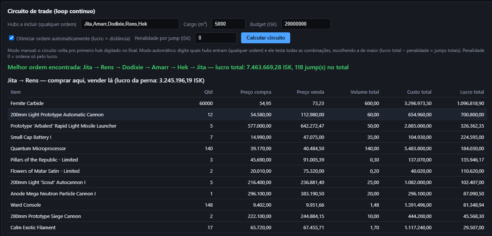

# eve-trade-circuit

Ferramenta de arbitragem de mercado pra EVE Online usando a **ESI oficial
da CCP**. Escaneia os 5 grandes hubs NPC (Jita, Amarr, Dodixie, Rens, Hek)
e, com login EVE opcional, também os **mercados de estruturas de
jogadores** que o seu personagem consegue acessar, na região onde ele está
(e nas regiões que você adicionar). Monta desde uma lista simples de
"compre aqui, venda ali" até um circuito completo de hauling com rota,
cargo e budget otimizados.

## Recursos

- **Scanner de arbitragem instantânea** — desce no livro de ofertas de
  verdade (não só a melhor ordem) pra achar a quantidade máxima que
  ainda dá lucro entre qualquer par de hubs.
- **Interface web local** (`webapp.py`) — tabela de oportunidades,
  cálculo de rota até compra/venda, e planejador de circuito, tudo no
  navegador, sem instalar nada além de Python.
- **Planejador de circuito (loop fechado)** — dado seu cargo hold (m³)
  e budget (ISK), monta o carregamento ótimo pra cada perna, priorizando
  sempre o maior lucro por m³.
- **Otimização automática de ordem** — testa todas as combinações de
  visita aos hubs escolhidos e escolhe a que maximiza lucro menos uma
  penalidade opcional por distância (jumps).
- **Login EVE SSO (opcional, vários personagens)** — libera mercados de
  estruturas (corp, aliança, blues, públicas) e classifica cada uma pelos
  seus contatos/standings.
- **Controle por local** — cada estação/estrutura tem uma caixa
  "contabilizar"; estruturas neutras e inimigas aparecem com aviso.
- **CLI simples** (`scanner.py`) pra quem só quer a tabela dos hubs NPC,
  sem abrir navegador.



## Sobre o EULA

Isso usa exclusivamente a API documentada da CCP (`esi.evetech.net`) e o
login oficial EVE SSO — o mesmo mecanismo usado por ferramentas
conhecidas como EVE Trade, Adam4EVE, etc. Não lê memória do jogo, não
automatiza nada dentro do cliente, só consulta dados que a própria CCP
disponibiliza para isso. O login só pede escopos de **leitura**.

## Instalação

```bash
pip install -r requirements.txt
# para rodar os testes:
pip install -r requirements-dev.txt
python -m pytest
```

## Login EVE (opcional) — estruturas de jogadores

Sem login, o app funciona só com os hubs NPC. Para incluir estruturas:

1. Crie um app em <https://developers.eveonline.com> (tipo
   "Authentication & API Access"):
   - **Callback URL:** `http://127.0.0.1:5000/callback`
   - **Escopos:** todos os listados em `config.SSO_SCOPES` (o login falha
     se o app pedir um escopo que não foi registrado):
     `esi-markets.structure_markets.v1`, `esi-universe.read_structures.v1`,
     `esi-search.search_structures.v1`, `esi-corporations.read_structures.v1`,
     `esi-characters.read_contacts.v1`, `esi-corporations.read_contacts.v1`,
     `esi-alliances.read_contacts.v1`, `esi-location.read_location.v1`,
     `esi-location.read_ship_type.v1`, `esi-skills.read_skills.v1`,
     `esi-assets.read_assets.v1`.
2. Rode `python webapp.py`, abra a página e cole o **Client ID** no painel
   "Conectar com EVE Online" (a página mostra a callback e os escopos pra
   copiar). Ele fica salvo em `local_settings.json`. Com PKCE não existe
   client secret.
3. Clique em **Entrar com EVE Online**: o servidor redireciona direto pra
   página de login da CCP, você escolhe o personagem e autoriza, e volta
   logado. Dá pra adicionar alts com **Adicionar personagem** e trocar o
   ativo na lista.

Como o Client ID de um app PKCE não é segredo, o dono do projeto pode
fixá-lo em `config.SSO_CLIENT_ID`: aí ninguém precisa do passo 1 nem do 2,
é só clicar e logar. Ordem de prioridade: variável `EVE_CLIENT_ID` →
`local_settings.json` → `config.SSO_CLIENT_ID`.

O refresh token fica no **cofre do sistema** (Windows Credential Manager /
Keychain / Secret Service, via `keyring`), nunca em arquivo. Em
`auth_state.json` fica só id, nome e escopos de cada personagem.

### Como as estruturas entram no scan

1. **Escopo:** região onde o personagem ativo está + regiões extras que
   você adicionar na interface (ou em `extra_region_ids`).
2. **Descoberta** de candidatas: estruturas públicas com mercado, ordens
   do feed regional localizadas em estruturas, seus assets, estruturas da
   sua corp (precisa do cargo Station Manager), busca por nome e a lista
   `manual_structure_ids`.
3. **Teste de acesso** (`/universe/structures/{id}` e
   `/markets/structures/{id}`). A ESI não tem um endpoint "estruturas que
   posso acessar", e cada 403 conta no limite de erros (100/min → bloqueio
   de todo o app). Por isso o resultado fica em cache **por personagem**:
   ok por 6h, negado por 24h, destruída por 7 dias. O teste pausa sozinho
   quando o orçamento de erros fica baixo.
4. **Classificação** do dono: `Corp`, `Aliança`, `Blue` (contato > 0),
   `Neutra`, `Red` (contato < 0). Contatos pessoais valem antes dos da
   corp, que valem antes dos da aliança. `overrides` em
   `local_settings.json` força a categoria de uma estrutura, corp ou
   aliança (ex.: corp em guerra = `"red"`).
5. Na tabela **Locais**, cada local tem a caixa **Contabilizar**:
   - Neutras vêm marcadas, com aviso (o dono pode mudar o acesso a
     qualquer momento).
   - **Red vêm desmarcadas** (`RED_STRUCTURE_POLICY = "reference_only"`):
     ficam no scan só como referência e não viram origem/destino de trade.
     Você pode marcá-las por sua conta e risco — itens podem ficar presos
     em asset safety se a ACL mudar, e o undock pode estar campado.
   - A escolha fica salva em `gui_settings.json`.

## Interface web local

```bash
python webapp.py
```

Abre um servidor **só em `127.0.0.1` (sua máquina, ninguém de fora acessa)**.
Abra `http://127.0.0.1:5000` no navegador. A página tem:

1. Botão **"Escanear mercado"** — dispara o scan em segundo plano no
   servidor e vai atualizando o status a cada segundo, até preencher a
   tabela de oportunidades.
2. Clique numa linha da tabela pra selecioná-la.
3. Digite seu **sistema de origem** (fica salvo em `gui_settings.json`
   pra próxima vez), marque/desmarque "evitar low-sec" e clique em
   **"Calcular rotas"**.
4. Mostra as duas rotas: **até o hub de compra** (de onde você está) e
   **do hub de compra até o hub de venda**.

### Circuito de trade (loop contínuo)

Depois de rodar um scan, use o painel "Circuito de trade" pra planejar
uma volta completa pelos hubs, comprando e vendendo em cada perna:

- **Locais do circuito**: marque quais entram e ordene com ↑↓. O
  circuito fecha automaticamente — a última perna sempre volta pro
  primeiro da lista. Só aparecem locais marcados como "contabilizar".
- **Cargo (m³)**: capacidade de carga do seu hauler. Pode ser o valor
  puro do cargo hold, ou já somado com expansores/riggeamento se for
  esse o fit que você for usar.
- **Budget (ISK)**: quanto você tem disponível pra girar em cada
  perna (não é total do circuito — é reaplicado a cada trecho, já que
  o dinheiro da venda da perna anterior vira o budget da próxima).

O algoritmo escolhe os itens por **densidade de lucro (ISK de lucro
por m³)** — enche o cargo com o que dá mais lucro por espaço primeiro,
respeitando tanto o limite de volume quanto o de ISK e a quantidade
realmente disponível nas ordens do mercado.

### Otimizar a ordem automaticamente (lucro × distância)

Marque **"Otimizar ordem automaticamente"** e a ordem da lista deixa de
importar: o sistema testa todas as combinações possíveis do loop entre os
locais incluídos (com 5 são só 24; o limite é
`config.MAX_OPTIMIZE_LOCATIONS = 8`) e escolhe a que maximiza:

```
score = lucro_total_do_circuito - penalidade_por_jump * jumps_totais
```

Com a **penalidade em 0** (padrão), ele ordena puramente pelo hub mais
lucrativo em cada trecho, ignorando distância. Suba a penalidade (ex:
500.000 ISK/jump) pra ele passar a preferir circuitos mais compactos
mesmo abrindo mão de um pouco de lucro. A distância em jumps entre cada
par de hubs é calculada uma vez via ESI e cacheada (`distance_cache.json`).

Deixa essa aba aberta e o EVE em modo janela ao lado — sem nenhuma
integração com o cliente do jogo, é só uma página consultando a ESI.

## Uso via linha de comando

```bash
python scanner.py
```

Isso baixa as ordens dos 5 hubs (pode levar um tempinho — Jita sozinho tem
dezenas de milhares de ordens), calcula margens e imprime uma tabela tipo:

```
Item                                   | Compra    |     Preço médio | Venda     |     Melhor preço |       Lucro/un | Margem | Qtd total |       Lucro pot.
Tritanium                              | Jita      |            5.35 | Rens      |             6.10 |            0.55 |  10.2% |     42000 |          23,100
...
```

Salvar em CSV também:

```bash
python scanner.py --csv oportunidades.csv
```

## Como o lucro é calculado (modo instantâneo)

Como você **não cria ordens** — só pega ordens de venda existentes pra
comprar e ordens de compra existentes pra vender — não há broker fee em
nenhuma das pontas. Só entra a **sales tax**, cobrada na venda:

```
sales_tax_rate = 7.5% * (1 - 0.11 * nível_de_Accounting)
lucro_por_unidade = preço_venda * (1 - sales_tax_rate) - preço_compra
```

Ordens de compra com **lote mínimo** (`min_volume`) só são usadas se a
quantidade lucrativa disponível alcança esse mínimo. Também contam ordens
de compra de outras estações/estruturas cujo **alcance** (`range` =
região ou sistema) cobre o local onde você vende.

Por padrão o script assume **Accounting nível 0** (conta Alpha, que não
pode treinar essa skill). Se sua conta for Omega e tiver a skill treinada:

```bash
python scanner.py --accounting 5
```

### Quantidade: soma profundidade real do livro de ofertas

Em vez de olhar só a melhor ordem de cada lado, o cálculo **desce no
livro**: casa as ordens de venda mais baratas (comprar) com as ordens de
compra mais generosas (vender), unidade por unidade, até o lucro daquela
unidade específica zerar. A "Qtd total" na tabela já é essa soma — o
máximo que ainda dá lucro nesse instante, não só o topo do book. O mesmo
vale pro planejador de circuito: ele monta uma lista de "lotes" (preço +
quantidade) de todos os itens candidatos, ordena tudo por **lucro por
m³** e enche o cargo/budget pegando sempre a maior densidade disponível
primeiro — sempre que há lucro, pega o máximo daquele material antes de
passar pro próximo.

## Limitações conhecidas (próximos passos)

- **Preço "agora" muda rápido.** Isso é uma foto do momento; convém rodar
  de novo antes de sair fazendo a rota.
- Modo "criar suas próprias ordens" (station trading) não está implementado
  — se quiser, dá pra adicionar calculando também broker fee de cada lado.
- A rota "evitar low-sec" usa a preferência *Safer* da ESI: prefere hisec,
  mas passa por low/null se não existir caminho só hisec. Confira a rota
  antes de sair com carga cara.
- Ordens de compra com alcance de **N jumps** só contam quando estão no
  mesmo sistema do local (falta o grafo do universo — próxima fase). O
  mesmo vale pra escopo por raio de jumps e alcance de jump freighter.
- Das estações NPC, só os 5 hubs entram no scan; as outras estações da
  região ainda não são escaneadas.
- O modo manual do circuito não recalcula rota/jumps entre as pernas —
  ele assume que você vai viajar do hub A pro hub B na ordem digitada.
  Use o modo "otimizar automaticamente" se quiser considerar distância.
- O budget é reaplicado igual em cada perna (não acumula o lucro da
  perna anterior automaticamente) — na prática seu ISK disponível cresce
  a cada volta, então o budget informado deveria ser atualizado conforme
  o circuito avança.

## Arquivos locais (fora do git)

| Arquivo | O que guarda |
|---|---|
| `local_settings.json` | client ID, IDs manuais de estruturas, regiões extras, overrides |
| `auth_state.json` | personagens logados (id, nome, escopos) — sem tokens |
| `gui_settings.json` | origem, "evitar low-sec", caixas "contabilizar", regiões extras da interface |
| `structure_access.json` | resultado do teste de acesso, por personagem |
| `*_cache.json` | volumes, distâncias, sistemas, corps, contatos |

## Licença

MIT — veja [LICENSE](LICENSE). Uso por sua conta e risco: preços de
mercado mudam a todo momento, e a responsabilidade por decisões de
trade dentro do jogo é sempre sua.
